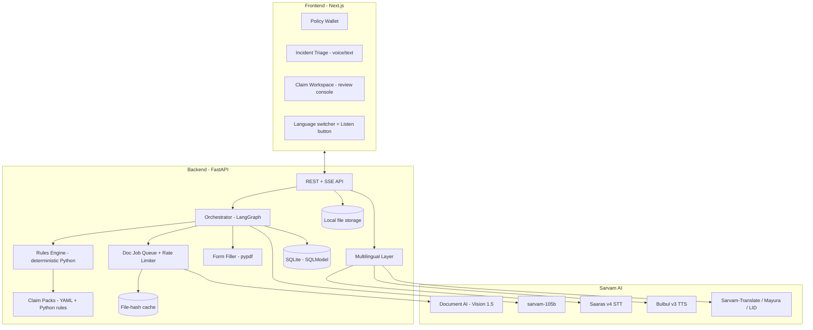
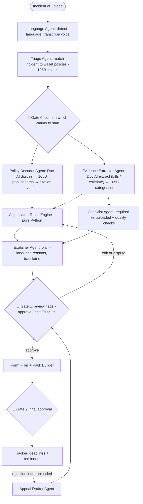
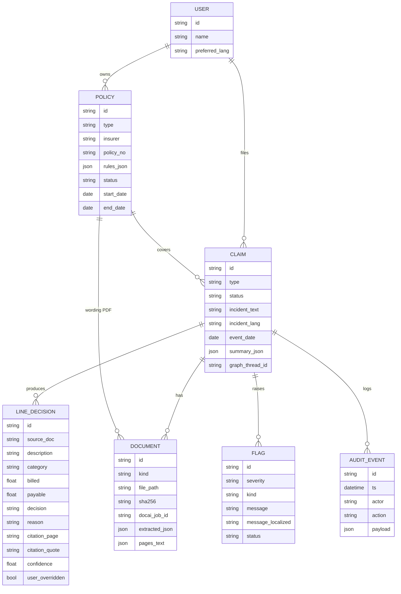

# ClaimMate: Full Implementation Plan

> **A multilingual AI claim copilot for Indian insurance, built on Sarvam AI**
> Hackathon: 30 hrs · Primary track: **01 Agentic AI** (also fits 02 and 03)
> Location: `C:\Users\Pankaj\Downloads\Agent`

---

## 0. TL;DR

ClaimMate stores a user's insurance policies in a **Policy Wallet**. When something happens (a hospitalisation or a car accident), the user **describes it in any Indian language, by voice or text**. ClaimMate then:

1. finds which policies apply,
2. reads the bills and documents,
3. calculates the expected payout **line by line, with policy-clause citations**,
4. flags missing documents and deadlines,
5. fills the claim form,
6. explains everything **back to the user in their own language, as text and audio**.

**A human approves every step.** The AI reads and explains, deterministic code calculates the money, and the user decides.

### Sarvam AI does all of the AI work

| Need | Sarvam product | Model / endpoint |
|---|---|---|
| Read policies, bills, discharge summaries, estimates (23 languages) | **Document AI** | Sarvam Vision 1.5 · `doc_ai.digitise()` / `doc_ai.extract()` |
| Reasoning, extraction, tool-using agents, explanations | **Chat Completion** | `sarvam-105b` (128K context, tool calling, `json_schema` structured output) |
| Voice input in any Indian language (incl. Hinglish / code-mixed) | **Speech-to-Text** | Saaras v4 · `speech_to_text.transcribe()` |
| Spoken summaries and answers | **Text-to-Speech** | Bulbul v3 · `text_to_speech.convert()` |
| Translate UI text, explanations, checklists | **Text Translation** | `sarvam-translate:v1` (23 languages) / `mayura:v1` (code-mixed mode) |
| Detect the user's language | **Language ID** | `text.identify_language()` |

---

## 1. Scope for 30 Hours

| Tier | What | Status at demo |
|---|---|---|
| ✅ **Deep** | **Health claim**: policy decode → bill extraction → adjudication → review → form → appeal | Fully working |
| ✅ **Medium** | **Motor claim**: repair estimate → depreciation + deductible → *"Should I claim?"* (no-claim bonus calculator) | Working |
| ✅ **Core** | **Policy Wallet + Incident Triage** (voice in any language → matching policies) | Working |
| ✅ **Core** | **Multilingual layer**: 11 languages for voice in/out + UI, 22 for document reading and text | Working |
| 🟡 **Stub** | Life, Travel, Property, Crop: Claim Pack YAML (checklist + deadlines + escalation) | Config only |
| ⚪ **Out of scope** | Real insurer submission, WhatsApp bot, payments, login beyond a demo user | Roadmap slide |

---

## 2. Sarvam API Constraints → Design Decisions

> [!IMPORTANT]
> These limits come from the Sarvam docs (Oct 2026). Check them against your plan in the dashboard at hour 0.

| Constraint | Impact | Design decision |
|---|---|---|
| Document AI: **max 10 pages per PDF/ZIP** | Policy wordings run 30–60 pages | `pdf_splitter.py` splits into 10-page chunks, runs jobs in parallel, then merges results **keeping the original page numbers** for citations |
| Document AI: **~10 req/min sustained** (Starter) | Bulk uploads hit the limit | Async job queue with a token-bucket limiter + **SHA-256 file-hash cache** (each file is processed only once) |
| Document AI is **async** (create → poll → fetch) | Seconds to minutes of latency | Background tasks + **Server-Sent Events** progress feed to the UI ("Reading bill 3 of 7…") |
| `sarvam-105b` is **text-only** | Can't read images directly | Pipeline: **Vision 1.5 (OCR/extract) → 105B (reasoning)**. Motor uses the **repair estimate document**, not photo-based damage assessment |
| 105B **reasoning is on by default** and counts toward `max_tokens` (Starter cap 4096) | Extraction calls can return empty content | Extraction calls: `reasoning_effort=None` + `response_format=json_schema (strict)`. Reasoning calls: `reasoning_effort="medium"`, `max_tokens` generous |
| 105B context **128K** | A 40-page policy ≈ 25–35K tokens | Send the whole policy in one call for decoding (no RAG needed for the MVP) |
| Translate: **2,000 chars/request** (sarvam-translate), 1,000 (mayura) | Long explanations | `chunk_text()` splits on sentences, translates in parallel, re-joins |
| TTS: **2,500 chars/request** | Long summaries | 105B writes a **short spoken script** (≤ 800 chars); chunk if longer |
| STT REST: **≤ 30 s audio** | Long voice notes | The UI caps a recording at 30 s (with a timer ring). Longer → Batch API (stretch) |
| Language coverage: **105B / Bulbul / Mayura = 11 languages**; Vision / Saaras / Translate = 23 | Not every language works end to end | **Tier A (11 languages)**: full voice in/out. **Tier B (other 12)**: text in/out via Translate, voice input via Saaras, English audio fallback |

---

## 3. System Architecture



### Agent graph (LangGraph with human-in-the-loop interrupts)



**Key design principle:** the LLM extracts and explains, Python calculates, a human approves. No rupee figure is ever produced by the LLM.

---

## 4. Tech Stack

| Layer | Choice | Notes |
|---|---|---|
| Language | Python 3.11+ (backend), TypeScript (frontend) | |
| Backend | **FastAPI** + Uvicorn | Async; `sse-starlette` for progress streaming |
| AI SDK | **`sarvamai`** (Python) | `AsyncSarvamAI` for concurrency |
| Orchestration | **LangGraph** + **`langchain-sarvam`** | `interrupt()` for human gates, SQLite checkpointer for resumable claims. *Fallback:* plain async functions + a status column if LangGraph slows you down |
| Validation | **Pydantic v2** | Every LLM output is validated; retry once on failure |
| DB | **SQLite + SQLModel** | Zero setup. Swap to Postgres later |
| PDF | **pypdf** (split, fill AcroForm, merge), **reportlab** (generate the claim summary PDF) | |
| Matching | **rapidfuzz** | Fuzzy match line items against the IRDAI non-payable list; name matching across documents |
| Frontend | **Next.js 14 (App Router) + Tailwind + shadcn/ui** | |
| Frontend libs | `react-pdf` (citation viewer), `@tanstack/react-query`, `zustand`, `recharts` (payout breakdown), native `MediaRecorder` (voice) | |
| i18n | `next-intl` with **message files pre-translated by Sarvam Translate** (build script) | Static UI strings are translated once; dynamic content at runtime |
| Testing | `pytest` (rules engine + golden claims), Playwright smoke test (stretch) | |

---

## 5. Repository Structure

```
Agent/
├── IMPLEMENTATION_PLAN.md          ← this file
├── README.md
├── .env.example
├── docker-compose.yml               (optional)
│
├── backend/
│   ├── pyproject.toml
│   ├── app/
│   │   ├── main.py                  # FastAPI app, CORS, routers
│   │   ├── config.py                # env settings (pydantic-settings)
│   │   ├── db.py                    # SQLModel engine/session
│   │   ├── models/                  # SQLModel tables
│   │   │   ├── user.py  policy.py  claim.py  document.py  flag.py  audit.py
│   │   ├── schemas/                 # Pydantic I/O + LLM JSON schemas
│   │   │   ├── policy_rules.py      # HealthPolicyRules, MotorPolicyRules
│   │   │   ├── evidence.py          # BillLineItem, RepairEstimate
│   │   │   └── adjudication.py      # LineDecision, ClaimSummary, Flag
│   │   ├── sarvam/                  # ⭐ all Sarvam calls live here
│   │   │   ├── client.py            # AsyncSarvamAI singleton, retries, timeouts
│   │   │   ├── ratelimit.py         # token buckets per API family
│   │   │   ├── cache.py             # sha256(file|params) → result (disk JSON)
│   │   │   ├── docai.py             # digitise/extract + split + poll + merge
│   │   │   ├── llm.py               # chat(), structured(), with_tools()
│   │   │   ├── speech.py            # transcribe(), speak()
│   │   │   └── translate.py         # translate(), detect_language(), chunking
│   │   ├── agents/
│   │   │   ├── graph.py             # LangGraph StateGraph + interrupts
│   │   │   ├── state.py             # ClaimState TypedDict
│   │   │   ├── language_agent.py
│   │   │   ├── triage_agent.py
│   │   │   ├── policy_decoder.py
│   │   │   ├── evidence_extractor.py
│   │   │   ├── checklist_agent.py
│   │   │   ├── explainer.py
│   │   │   ├── appeal_drafter.py
│   │   │   ├── assistant.py         # conversational Q&A agent with tools
│   │   │   └── prompts/             # *.md prompt templates
│   │   ├── engine/                  # ⭐ deterministic, no LLM
│   │   │   ├── base.py              # Rule, Decision, Engine
│   │   │   ├── health.py            # room-rent ratio, non-payables, co-pay, sublimits, waiting periods
│   │   │   ├── motor.py             # depreciation, deductible, NCB calculator
│   │   │   └── citations.py         # quote verification against page text
│   │   ├── packs/                   # Claim Pack configs
│   │   │   ├── health.yaml  motor.yaml  life.yaml  travel.yaml  property.yaml  crop.yaml
│   │   │   └── loader.py
│   │   ├── data/
│   │   │   ├── irdai_non_payables.json
│   │   │   ├── motor_depreciation.json
│   │   │   ├── glossary_protected_terms.json
│   │   │   └── forms/health_claim_form_partA.pdf
│   │   ├── services/
│   │   │   ├── form_filler.py
│   │   │   ├── pack_builder.py      # merged, indexed PDF document pack
│   │   │   ├── deadlines.py
│   │   │   └── audit.py
│   │   └── routers/
│   │       ├── wallet.py  claims.py  documents.py  review.py  voice.py  i18n.py  events.py
│   └── tests/
│       ├── test_health_engine.py
│       ├── test_motor_engine.py
│       ├── test_citations.py
│       └── golden/                  # 5 synthetic claims + expected payouts
│
├── frontend/
│   ├── package.json
│   ├── messages/                    # en.json, hi.json, ta.json … (generated)
│   ├── scripts/translate-messages.ts# Sarvam Translate → messages/*.json
│   └── src/
│       ├── app/
│       │   ├── [locale]/page.tsx                 # landing + wallet
│       │   ├── [locale]/incident/page.tsx        # voice/text triage
│       │   ├── [locale]/claims/[id]/page.tsx     # claim workspace
│       │   └── [locale]/claims/[id]/review/page.tsx
│       ├── components/
│       │   ├── VoiceRecorder.tsx  ListenButton.tsx  LanguageSwitcher.tsx
│       │   ├── PayoutSummaryCard.tsx  LineItemTable.tsx  FlagCard.tsx
│       │   ├── CitationViewer.tsx  AgentTimeline.tsx  ChecklistPanel.tsx
│       │   ├── WhatIfSlider.tsx  ShouldIClaimCard.tsx  PolicyCard.tsx
│       └── lib/ api.ts  sse.ts  store.ts
│
└── demo-data/
    ├── policies/        # public policy wording PDFs (health + motor)
    ├── health_case_1/   # bills (PDF + phone photos), discharge summary, Rx, reports
    ├── motor_case_1/    # RC, DL, repair estimate, FIR
    ├── rejection_letter.pdf
    ├── voice/           # pre-recorded Hindi/Tamil incident clips
    └── ground_truth.xlsx
```

---

## 6. Data Model



`CLAIM.status` state machine: `draft → extracting → adjudicated → awaiting_review → approved → pack_ready → submitted_by_user → settled | rejected → appealing`

---

## 7. Sarvam Integration Layer (core code skeletons)

### 7.1 Client, rate limits, cache: `app/sarvam/client.py`
```python
from sarvamai import AsyncSarvamAI
from app.config import settings

client = AsyncSarvamAI(api_subscription_key=settings.SARVAM_API_KEY, timeout=60.0)
RETRY = {"max_retries": 3, "timeout_in_seconds": 90}
```
```python
# app/sarvam/ratelimit.py: one async token bucket per API family
BUCKETS = {
    "docai": TokenBucket(rate_per_min=9, burst=9),     # stay under 10/min
    "chat": TokenBucket(rate_per_min=50, burst=10),
    "speech": TokenBucket(rate_per_min=50, burst=10),
    "translate": TokenBucket(rate_per_min=50, burst=20),
}
```
```python
# app/sarvam/cache.py: disk cache keyed by sha256(file bytes + op + params)
# DEMO_MODE=true → serve only from cache (no network risk on stage)
```

### 7.2 Document AI with page-preserving split: `app/sarvam/docai.py`
```python
async def digitise_pdf(path: Path, lang="en-IN") -> list[PageText]:
    """Split into ≤10-page chunks, digitise each (md), return [{page_no, markdown}] with GLOBAL page numbers."""
    chunks = split_pdf(path, max_pages=10)            # pypdf → [(tmp_path, start_page)]
    results = await asyncio.gather(*[_digitise_chunk(p, start, lang) for p, start in chunks])
    return sorted(itertools.chain(*results), key=lambda p: p.page_no)

async def _digitise_chunk(p, start_page, lang):
    await BUCKETS["docai"].acquire()
    with open(p, "rb") as f:
        job = await client.doc_ai.digitise(file=[(p.name, f, "application/pdf")],
                                           language=lang, output_format="md")
    st = await poll(job.job_id)                        # terminal: completed / partially_completed / failed / rejected
    zip_bytes = await download(job.job_id)             # zip: primary .md + metadata/page_NNN.json
    return parse_pages(zip_bytes, offset=start_page - 1)

async def extract_fields(path: Path, schema: dict, lang="en-IN") -> dict:
    """Schema-based extraction (bills, estimates, KYC). schema must be passed as a JSON STRING."""
    await BUCKETS["docai"].acquire()
    with open(path, "rb") as f:
        job = await client.doc_ai.extract(file=[(path.name, f, mime(path))],
                                          schema=json.dumps(schema), language=lang, output_format="json")
    await poll(job.job_id)
    return (await client.doc_ai.get_results(job_id=job.job_id)).result
```
> Doc AI schema rules: root `type: object`, every field needs `type` + a **non-empty, specific `description`**, max nesting depth 4.

### 7.3 LLM helpers: `app/sarvam/llm.py`
```python
async def structured(system: str, user: str, schema_model: type[BaseModel], name: str):
    """Deterministic extraction: no reasoning, strict JSON schema, pydantic-validated, 1 retry."""
    await BUCKETS["chat"].acquire()
    resp = await client.chat.completions(
        model="sarvam-105b",
        messages=[{"role": "system", "content": system}, {"role": "user", "content": user}],
        response_format={"type": "json_schema",
                         "json_schema": {"name": name, "strict": True,
                                         "schema": schema_model.model_json_schema()}},
        reasoning_effort=None, temperature=0.1, max_tokens=4000,
    )
    return schema_model.model_validate_json(resp.choices[0].message.content)

async def reason(messages, tools=None, effort="medium", max_tokens=4000):
    """Agentic calls (triage, assistant, appeal): tool calling + think mode."""
    ...
```
> ⚠️ Pydantic's JSON schema may need light post-processing for `strict` mode (add `additionalProperties: false`, inline `$defs`). Write a `to_strict_schema()` helper at hour 2.

### 7.4 Speech: `app/sarvam/speech.py`
```python
async def transcribe(audio: bytes, filename: str) -> Transcript:
    # Saaras v4, auto language detection; codemix keeps Hinglish natural
    r = await client.speech_to_text.transcribe(file=(filename, audio), model="saaras:v4", mode="transcribe")
    return Transcript(text=r.transcript, lang=r.language_code)

async def speak(text: str, lang: str, speaker: str = "shubh") -> bytes:
    chunks = chunk_text(text, 2400)
    audios = [await client.text_to_speech.convert(text=c, language_code=lang,
                                                  model="bulbul:v3", speaker=speaker) for c in chunks]
    return concat_wav(audios)
```

### 7.5 Translation with protected terms: `app/sarvam/translate.py`
```python
PROTECTED = load("glossary_protected_terms.json")  # "₹", amounts, "Clause 4.2", policy numbers, "IRDAI"

async def translate(text: str, target: str, source="auto", mode="formal") -> str:
    masked, mapping = mask_tokens(text, PROTECTED_REGEX)   # ₹1,21,300 → ⟦0⟧, Cl. 4.2 → ⟦1⟧
    parts = chunk_by_sentence(masked, 1900)
    out = await asyncio.gather(*[client.text.translate(input=p, source_language_code=source,
                                 target_language_code=target, model="sarvam-translate:v1", mode=mode)
                                 for p in parts])
    return unmask(" ".join(o.translated_text for o in out), mapping)
```
> **Masking matters:** money, clause numbers and policy IDs must never be changed by translation. Masking them is a small trust feature worth pointing out to judges.
> Use `mayura:v1` with `mode="code-mixed"` when the user spoke Hinglish. Replies come back in the same mixed style they used.

---

## 8. Agents: Responsibilities, Inputs/Outputs, Prompts

| Agent | Sarvam calls | Input | Output | Tools |
|---|---|---|---|---|
| **Language Agent** | Saaras v4, LID | audio / text | `{text_en, original_text, lang}` | — |
| **Triage Agent** | 105B (think, tools) | incident text (EN) + wallet summary | `[{policy_id, claim_type, why, est_relevance, urgent_deadline}]` | `list_policies`, `get_policy_rules`, `compute_deadlines` |
| **Policy Decoder** | Doc AI digitise → 105B structured | policy PDF | `HealthPolicyRules` / `MotorPolicyRules` with **`{value, page, quote}`** per rule | — |
| **Citation Verifier** | none (Python) | rules + page texts | each rule marked `verified` / `unverified` | rapidfuzz partial_ratio ≥ 85 |
| **Evidence Extractor** | Doc AI extract → 105B structured (categorise) | bills / estimate | `[BillLineItem{desc, qty, rate, amount, date, category, confidence}]` | non-payables lookup |
| **Adjudicator** | **none** | rules + line items | `[LineDecision]` + `ClaimSummary` | Rules Engine |
| **Checklist Agent** | 105B (light) | pack checklist + extracted docs | missing / invalid docs with reasons | name match, date-window check |
| **Explainer** | 105B + Translate + Bulbul | decisions + flags + `lang` | localized flag messages, 60-sec spoken script, audio | — |
| **Appeal Drafter** | Doc AI (letter) + 105B (think) | rejection letter + rules + decisions | grievance letter (EN + local language) + escalation steps | `get_clause`, `get_irdai_rule` |
| **Assistant (chat)** | 105B tools + STT/TTS | user question in any language | grounded answer with citations | `get_claim_summary`, `explain_line`, `what_if_room_rent`, `get_clause` |

### Prompt rules (put in every system prompt)
1. "You never calculate payouts. Monetary values come only from tool results."
2. "Every claim about the policy must include `page` and an exact `quote` from the provided text. If not found, return `null` and set `confidence: low`."
3. "If unsure, ask the human. Do not guess."
4. "Respond in `{lang}`. Keep ₹ amounts, clause numbers and policy numbers unchanged."

### Policy Decoder JSON schema (health excerpt)
```python
class Cited(BaseModel):
    value: float | int | str | bool | None
    page: int | None
    quote: str | None          # exact sentence from the policy
    confidence: Literal["high", "medium", "low"]

class HealthPolicyRules(BaseModel):
    insurer: Cited; policy_number: Cited; insured_members: list[str]
    sum_insured: Cited
    room_rent_cap_type: Cited      # "percent_si_per_day" | "fixed_per_day" | "room_category" | "none"
    room_rent_cap_value: Cited
    icu_cap_type: Cited; icu_cap_value: Cited
    copay_percent: Cited
    pre_hosp_days: Cited; post_hosp_days: Cited
    sublimits: list[SubLimit]      # {procedure, limit, page, quote}
    initial_waiting_days: Cited; ped_waiting_months: Cited; specific_disease_waiting: list[...]
    exclusions: list[Exclusion]    # {text, page, quote, keywords[]}
    claim_intimation_hours: Cited; claim_submission_days: Cited
    policy_start_date: Cited; policy_end_date: Cited
```

---

## 9. Rules Engine (deterministic)

### 9.1 Health: `engine/health.py`
Order of operations (each step writes a `LineDecision` with `reason` + `citation`):

| # | Rule | Logic |
|---|---|---|
| H1 | **Eligibility** | Admission date inside the policy period. Diagnosis vs initial / PED / specific waiting periods → else `flag: uncertain` (human check) |
| H2 | **Exclusions** | Diagnosis/procedure keyword match against exclusions → `uncertain` (never auto-deny) |
| H3 | **IRDAI non-payables** | fuzzy match (`rapidfuzz ≥ 88`) against `irdai_non_payables.json` (List I) → `deducted` |
| H4 | **Subsumed items** | List II (room) / III (procedure) / IV (treatment) items → `deducted: included in package` |
| H5 | **Room-rent cap** | `ratio = min(1, cap_per_day / actual_room_rent_per_day)` (ICU separately) |
| H6 | **Proportionate deduction** | Associated medical charges (doctor, nursing, OT, surgeon, anaesthetist) × `ratio`. **Excluded from proportionate cut:** pharmacy, consumables, implants, diagnostics *(verify against the current IRDAI master circular)* |
| H7 | **Pre/post-hospitalisation** | Bills dated within `[admit − pre_days, admit)` and `(discharge, discharge + post_days]` → payable. **Highlight them as "you might have missed these"** |
| H8 | **Sub-limits** | Cap the procedure total at its sub-limit |
| H9 | **Co-pay** | `payable × (1 − copay%)` |
| H10 | **Sum insured cap** | `min(total, remaining_SI)` |

```python
@dataclass
class LineDecision:
    line_id: str; billed: Decimal; payable: Decimal
    decision: Literal["payable", "partial", "deducted", "uncertain"]
    rule_id: str; reason_en: str; citation: Citation | None; confidence: float
```
**What-if API:** `POST /claims/{id}/what-if {room_rent_per_day: 5000}` reruns H5–H10 without any LLM call, so the slider updates instantly.

### 9.2 Motor: `engine/motor.py`
| # | Rule | Logic *(verify slabs against the current IRDAI motor tariff / policy wording)* |
|---|---|---|
| M1 | **Part depreciation** | Rubber/plastic/nylon/batteries/tyres/airbags 50%; fibreglass 30%; glass 0%; metal parts by vehicle age (0% → 50%) from `motor_depreciation.json` |
| M2 | **Zero-dep add-on** | If present → skip M1 |
| M3 | **Compulsory deductible** | e.g. ₹1,000 (≤1500cc) / ₹2,000 (>1500cc) + voluntary deductible |
| M4 | **Labour** | Not depreciated (paint material rules per policy) |
| M5 | **Should I claim?** | `net_claim = estimate − depreciation − deductible`. `ncb_loss = Σ (premium × ncb_drop_by_year)` over the next 3 renewals. Recommend **claim** if `net_claim > ncb_loss + buffer` |

### 9.3 Tests (write first, ~hour 3)
- `test_health_engine.py`: room-rent ratio maths, pharmacy not proportionate, co-pay order, sub-limit, SI cap
- `golden/`: 5 synthetic claims with hand-computed expected payouts (from `ground_truth.xlsx`) → **assert within ±1%**
- `test_citations.py`: hallucinated quote → `unverified`

---

## 10. Claim Packs (extensibility)

```yaml
# packs/travel.yaml  (stub: shows how a new insurance type is added with config only)
type: travel
display_name: { en: "Travel Insurance", hi: "यात्रा बीमा" }
triggers: [flight delay, baggage lost, trip cancelled, medical abroad]
policy_schema: TravelPolicyRules
checklist:
  - { id: boarding_pass, required: true, desc: "Boarding pass / e-ticket" }
  - { id: airline_delay_letter, required_if: "incident == flight_delay" }
  - { id: pir_report, required_if: "incident == baggage_lost", desc: "Property Irregularity Report" }
deadlines:
  - { id: intimation, within_days: 7, from: incident_date }   # verify per policy
escalation: [insurer_gro, bima_bharosa, insurance_ombudsman]
rules_module: null            # stub → checklist + deadlines only
```
Health and Motor packs point to `engine.health` / `engine.motor`.

---

## 11. Multilingual Experience (Sarvam's main contribution)

| Touchpoint | How |
|---|---|
| **Language picker** on first launch (11 Tier-A languages + "More") | Saved in `user.preferred_lang` |
| **Static UI** | `messages/en.json` → `scripts/translate-messages.ts` (Sarvam Translate) → `hi.json`, `ta.json`, `te.json`, `bn.json`, `mr.json`, `gu.json`, `kn.json`, `ml.json`, `pa.json`, `od.json`. Hand-check the Hindi file |
| **Voice incident input** | 🎤 hold to talk (≤30 s) → Saaras v4 auto-detects language → transcript shown for **user confirmation** (a human gate!) |
| **Dynamic content** (flags, reasons, checklist, appeal) | Generated in English → masked translation → cached per `(claim, lang)` |
| **🔊 Listen** | Explainer writes a ≤60-sec spoken script → Bulbul v3 in the user's language |
| **Ask anything** (chat + voice) | "₹16,850 क्यों कटे?" → STT → Assistant (tools) → answer + citation → TTS |
| **Code-mixed users** | If the transcript is Hinglish → replies via `mayura:v1 mode=code-mixed` |
| **Regional documents** | Hindi/Marathi/Tamil hospital bills → Vision 1.5 with `language=<code>` |
| **Bilingual appeal letter** | English (for the insurer) + local-language copy (for the user to understand) |

---

## 12. API Endpoints

| Method | Path | Purpose |
|---|---|---|
| `POST` | `/wallet/policies` (multipart) | Upload policy PDF → background decode job |
| `GET` | `/wallet/policies` | List policies + decoded rules (with citations) |
| `GET` | `/wallet/policies/{id}` | Policy card + rules + page texts |
| `POST` | `/incidents` (text or audio) | Language detect + transcribe → triage → suggested claims |
| `POST` | `/claims` | Create a claim from a triage suggestion (Gate 0) |
| `POST` | `/claims/{id}/documents` (multipart) | Upload bills / estimates / reports |
| `POST` | `/claims/{id}/run` | Start the extraction → adjudication graph |
| `GET` | `/claims/{id}/events` (SSE) | Live agent timeline / progress |
| `GET` | `/claims/{id}` | Summary, line decisions, flags, checklist |
| `PATCH` | `/claims/{id}/lines/{line_id}` | User override (recategorise / mark payable) → recompute |
| `POST` | `/claims/{id}/flags/{flag_id}` | approve / dispute + comment |
| `POST` | `/claims/{id}/approve?gate=1\|2` | Resume the LangGraph interrupt |
| `POST` | `/claims/{id}/what-if` | Room-rent / NCB simulation |
| `GET` | `/claims/{id}/form.pdf` · `/claims/{id}/pack.pdf` | Filled form / merged document pack |
| `POST` | `/claims/{id}/appeal` (rejection letter) | Draft appeal + escalation path |
| `POST` | `/assistant/ask` (text or audio, `lang`) | Grounded Q&A → `{text, citations, audio_url}` |
| `POST` | `/i18n/translate` · `/voice/tts` · `/voice/stt` | Utility endpoints |
| `GET` | `/claims/{id}/audit` | Full audit trail |

---

## 13. Frontend Screens

| # | Screen | Key components | Wow detail |
|---|---|---|---|
| 1 | **Language picker + Wallet** | `LanguageSwitcher`, `PolicyCard` grid, upload dropzone | Policy card in Tamil: "Room rent limit ₹5,000/day · Co-pay 10%" with 📄 citation links |
| 2 | **"Something happened"** | big 🎤 `VoiceRecorder`, transcript confirm, triage results | Speak in Hindi → 4 matching policies, incl. the hidden personal accident cover |
| 3 | **Claim Workspace** | `AgentTimeline` (SSE), upload zone, `PayoutSummaryCard`, `ChecklistPanel` | Agents work live: "Reading bill 3/7 (Marathi)…" |
| 4 | **Review Console** | `LineItemTable` (filter: deducted/uncertain), `FlagCard` (approve/edit/dispute), `CitationViewer` (PDF page with highlighted quote) | Click a deduction → policy page opens with the clause highlighted |
| 5 | **What-if / Should-I-claim** | `WhatIfSlider` (room rent), `ShouldIClaimCard` (motor NCB) | Slider moves → payout recalculates instantly |
| 6 | **Claim Pack** | form preview, pack download, deadline calendar | Auto-filled official form |
| 7 | **Ask ClaimMate** (drawer on every page) | chat + mic + 🔊 | Ask in Tamil, hear the answer in Tamil |
| 8 | **Appeal** | rejection upload → bilingual letter + escalation stepper | GRO → Bima Bharosa → Ombudsman timeline |

**Design:** clean "fintech-trust" look. Green = payable, amber = uncertain, red = deducted. Large type and an accessibility mode (bigger text, fully voice-led) for elderly users.

---

## 14. Demo Data Plan

| Asset | How to create |
|---|---|
| 1 health policy + 1 motor policy | Public policy wording PDFs from insurer websites (choose a health policy **with a room-rent cap + co-pay**) |
| Health case: 7 bills | HTML templates → PDF. **Print 2 and photograph them** (tilt, shadows). **Make 1 bill in Hindi/Marathi** to show off Vision 1.5 |
| Discharge summary | Synthetic; one version *without* a signature (to trigger a flag) |
| Planted issues | room above the cap, gloves/admission kit, pharmacy bill without Rx, pre-hospitalisation MRI 12 days before admission, post-hospitalisation pharmacy 20 days after |
| Motor case | Synthetic RC, DL, garage estimate (plastic bumper, glass, metal door, labour), vehicle 3 yrs old, NCB 35% |
| Voice clips | Team members record the incident in **Hindi, Tamil and Hinglish** (backup for a noisy venue) |
| Rejection letter | Synthetic: "claim repudiated under PED exclusion" |
| `ground_truth.xlsx` | Hand-computed payouts for 5 claims → the golden tests |

> [!CAUTION]
> Only synthetic personal data. No real Aadhaar, PAN or medical records.

---

## 15. 30-Hour Execution Plan (team of 4)

**Roles**
- **A: AI & Sarvam**: `app/sarvam/*`, agents, prompts, LangGraph
- **B: Engine & Backend**: rules engine, packs, DB, API, form filler, tests
- **C: Frontend**: all screens, SSE, voice recorder, i18n
- **D: Data, Multilingual & Pitch**: demo data, ground truth, translations QA, voice clips, deck, video

### Phase 0: Before the clock starts (or hour 0, ~1 hr)
- [ ] Sarvam API key, check credits + plan limits; **request V2 beta access** (in case it's needed)
- [ ] Repo scaffold (backend + frontend), `.env`, a shared Postman/Bruno collection
- [ ] Smoke-test every Sarvam API once: digitise, extract, chat (json_schema + tools), STT, TTS, translate

### Phase 1: Foundations (H0 → H6)
| Owner | Tasks | Done when |
|---|---|---|
| A | `client.py`, `ratelimit.py`, `cache.py`, `docai.py` (split + poll + merge), `llm.structured()` | A 40-page policy is digitised with correct page numbers |
| B | SQLModel tables, `engine/health.py` H3–H10 on hardcoded JSON + unit tests | `pytest` green on room-rent / co-pay / sub-limit |
| C | Next.js scaffold, layout, wallet page, upload dropzone, API client | Upload hits the backend |
| D | Policies chosen, 7 bills + photos, ground truth for case 1, `irdai_non_payables.json` | Case 1 expected payout known |

### Phase 2: End-to-end health happy path (H6 → H13) 🎯 Milestone M1
| Owner | Tasks |
|---|---|
| A | Policy Decoder (schema + prompt + citation verifier); Evidence Extractor (Doc AI extract schema + 105B categoriser) |
| B | Wire decoder + extractor → engine; `/claims/*` endpoints; SSE events; H1/H2/H7 |
| C | Claim workspace, `AgentTimeline` (SSE), `PayoutSummaryCard`, `LineItemTable` |
| D | Golden cases 2–5, motor demo data, record voice clips |

**M1 (H13):** upload policy + bills → the payout summary on screen matches ground truth within ±2%. *Commit + tag `m1`.*

### Phase 3: Human-in-control + multilingual (H13 → H20) 🎯 Milestone M2
| Owner | Tasks |
|---|---|
| A | LangGraph graph with `interrupt()` gates; Explainer (spoken script); `translate.py` masking; `speech.py` |
| B | Overrides → recompute; what-if endpoint; checklist agent rules (name match, date window, Rx↔pharmacy); audit trail |
| C | Review console (`FlagCard`, `CitationViewer` with highlight), `WhatIfSlider`, `VoiceRecorder`, `ListenButton`, `LanguageSwitcher` |
| D | Run `translate-messages` → 10 locale files; QA the Hindi + one more language; start the deck |

**M2 (H20):** full health flow in Hindi with voice, gates working, citations clickable.

### Phase 4: Wallet, triage, motor, form (H20 → H25) 🎯 Milestone M3
| Owner | Tasks |
|---|---|
| A | Triage Agent (tools), Assistant Q&A agent, Appeal Drafter (stretch) |
| B | `engine/motor.py` + Should-I-claim; form filler + pack builder; pack YAML loader + stubs |
| C | Incident page, triage results, `ShouldIClaimCard`, form preview, Ask drawer |
| D | Pitch deck v1, demo script, cache warm-up of all demo files (`DEMO_MODE`) |

**M3 (H25):** the full 3-minute demo runs end to end.

### Phase 5: Hardening & pitch (H25 → H30)
- [ ] **Feature freeze at H26.** Bug fixes only
- [ ] Run the demo 5× from a clean state with `DEMO_MODE=true` (cached Sarvam responses) **and** once live
- [ ] Record a **backup demo video** (H27)
- [ ] Accessibility pass (font scale, contrast), loading/error states, empty states
- [ ] README with setup + architecture diagram + Sarvam usage table
- [ ] Rehearse the pitch 3×, assign Q&A owners

> [!TIP]
> **Sleep shifts:** A+C sleep H14–H17, B+D sleep H17–H20 (adjust to taste). Never have all 4 asleep at once.

---

## 16. Demo Script (3 min)

| Time | Beat | Sarvam feature shown |
|---|---|---|
| 0:00 | Hook: "₹26,000 crore in health claims cut or rejected in FY24 (IRDAI). And most Indians can't even read their policy, which is written in English legalese." | — |
| 0:20 | Pick **हिन्दी** → wallet shows 2 decoded policies in Hindi, with citations | Translate, Vision |
| 0:40 | 🎤 *"Papa ka accident hua, 3 din hospital mein the"* → 4 matching policies | Saaras (code-mixed), 105B tools |
| 1:00 | Upload bills (one photographed, one in Marathi) → live agent timeline | Vision 1.5 (multilingual OCR) |
| 1:25 | **Aha screen:** ₹1,21,300 payable · ₹27,300 deductions explained · ₹12,400 you'd have missed · 2 documents missing | Engine + Explainer |
| 1:50 | Click the room-rent deduction → clause highlighted → slider: "twin-sharing would save ₹16,850" | Citations, what-if |
| 2:10 | Dispute a flag → recompute → approve → **form auto-filled** | Human gates |
| 2:25 | 🔊 "Listen": summary spoken in Hindi; ask "दवाई का पैसा क्यों कटा?" → spoken answer | Bulbul, Assistant |
| 2:40 | Motor: "Don't claim, you'd lose ₹6,800 of no-claim bonus to recover ₹4,500" | Engine |
| 2:50 | Close: "The AI reads and explains, code calculates, you decide. In 11 Indian languages." | — |

---

## 17. Judging Criteria Mapping

| Likely criterion | How ClaimMate scores |
|---|---|
| **Agentic (reason, plan, use tools)** | Orchestrator + 8 specialised agents, tool calling, multi-claim planning, resumable state |
| **Humans in control** | 3 approval gates, editable decisions, citations, confidence, audit trail, no auto-submission |
| **Real-world impact** | ₹26K cr problem, clear personas, measurable ₹ recovered + hours saved |
| **Technical depth** | Page-preserving doc pipeline, citation verification, deterministic engine, masked translation, rate-limited async queue |
| **Inclusivity** | 11-language voice in/out, regional-language document reading, accessibility mode |
| **Completeness / polish** | End-to-end flow, golden-test accuracy, backup video |

---

## 18. Risks & Mitigations

| Risk | Likelihood | Mitigation |
|---|---|---|
| Doc AI latency or rate limit during the live demo | High | `DEMO_MODE` cache, pre-warmed files, backup video |
| 105B returns schema-invalid JSON | Medium | `strict` json_schema + pydantic validation + 1 retry + `reasoning_effort=None` |
| Wrong policy rule extracted | Medium | Citation verifier → `unverified` rules go to the human; demo policy pre-checked |
| Translation alters numbers or clauses | Medium | Token masking + post-check that all masked tokens survived |
| Noisy venue breaks STT | Medium | Pre-recorded voice clips as a fallback upload |
| Scope creep (7 insurance types) | High | Strict tiers (§1). Stubs are YAML only |
| LangGraph learning curve | Medium | Fallback: plain async pipeline + `claim.status` column for gates |
| Regulatory claims in the pitch | Low | Say "estimate, not a settlement guarantee", verify all IRDAI references |

---

## 19. Environment & Setup

```bash
# .env.example
SARVAM_API_KEY=sk_xxx
DEMO_MODE=false                 # true = serve Sarvam responses from cache only
DATABASE_URL=sqlite:///./claimmate.db
STORAGE_DIR=./storage
CACHE_DIR=./.sarvam_cache
DEFAULT_LANG=hi-IN
NEXT_PUBLIC_API_URL=http://localhost:8000
```

```bash
# backend
cd backend
python -m venv .venv && .venv\Scripts\activate
pip install fastapi uvicorn[standard] sse-starlette sarvamai langgraph langchain-sarvam \
            pydantic pydantic-settings sqlmodel pypdf reportlab rapidfuzz python-multipart pyyaml pytest
uvicorn app.main:app --reload

# frontend
cd frontend
npx create-next-app@latest . --ts --tailwind --app --src-dir
npm i sarvamai next-intl @tanstack/react-query zustand react-pdf recharts
npx shadcn@latest init
npm run dev
```

---

## 20. Post-Hackathon Roadmap
1. WhatsApp intake (Sarvam has a Twilio WhatsApp cookbook) + Sarvam Voice Agents for a phone helpline
2. NHCX / Bima Sugam integration for direct digital filing
3. Life (Policy Finder from bank statements), Travel, Property, Crop (PMFBY) packs with full rule engines
4. B2B dashboard for hospital insurance desks + employer HR benefits
5. Self-hosted Sarvam deployment for DPDP-compliant health data handling

---

### Verify before the pitch
- [ ] IRDAI FY24 figures (₹26,000 cr; ₹15,100 cr disallowed / ₹10,937 cr repudiated)
- [ ] Current IRDAI non-payable lists and proportionate-deduction exclusions
- [ ] Motor depreciation slabs, compulsory deductibles, NCB slabs
- [ ] Ombudsman monetary limit + Bima Bharosa process
- [ ] Sarvam plan limits on your key (Doc AI req/min, chat `max_tokens`)
