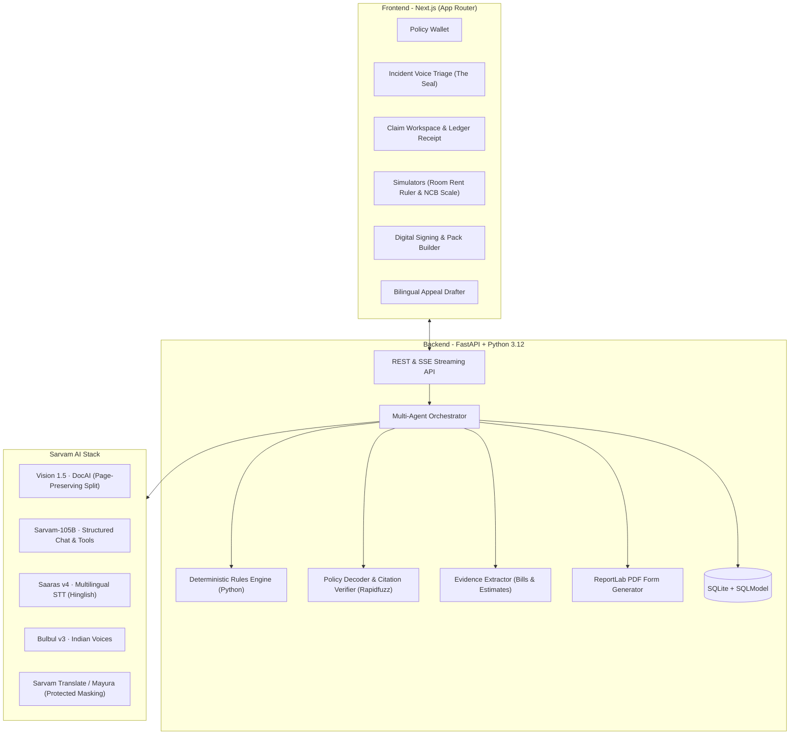

# ClaimMate (क्लेममेट)

> **A Multilingual AI Claim Copilot for Indian Insurance**  
> *Concept: "The Modern Bahi-Khata" (पारंपरिक बही-खाता, आधुनिक तकनीक)*  
> Powered by **Sarvam AI** (Vision 1.5 · Sarvam-105B · Saaras v4 · Bulbul v3 · Mayura · Translate)

---

## 0. Overview

**₹26,000 crore** of health insurance claims were cut or rejected in India in FY24 (IRDAI Annual Report). Most policyholders cannot decipher English insurance legalese or understand why hospital deductions were made.

**ClaimMate** fixes this:
1. **Policy Wallet**: Stores and decodes policies (Health, Motor, Life, Travel, Property, PMFBY Crop) with grounded page citations.
2. **Incident Triage in 11 Indian Languages**: Voice intake in Hindi, Tamil, Telugu, Bangla, Marathi, Hinglish, etc., matching incidents across policies.
3. **Deterministic Rules Engine**: Calculates payouts line-by-line using Python without rupee hallucinations:
   - **Health**: Room-rent capping, proportionate deductions on associated charges, non-payable consumables (IRDAI List I), and unlocked pre/post-hospitalisation benefits.
   - **Motor**: Part depreciation (plastics, glass, metal age slabs), deductibles, and a *"Should I Claim?"* No-Claim Bonus calculator.
4. **Human-in-Control Gates**:
   - **Gate 0**: Confirm policies to initiate from triage.
   - **Gate 1**: Review flags, inspect calculations, edit/dispute deductions.
   - **Gate 2**: Final approval using a **1.2s physical "Hold to Sign"** gesture.
5. **Auto-filled Claim Pack & Appeals**: Generates filled IRDAI Claim Form Part A summaries, indexed document packages, and bilingual grievance letters with a 3-tier escalation track (Insurer GRO → Bima Bharosa → Insurance Ombudsman).

---

## 1. Architecture



---

## 2. Sarvam AI Integration Matrix

| Product | Model / Endpoint | Implementation in ClaimMate |
|---|---|---|
| **Document AI** | Sarvam Vision 1.5 · `doc_ai.digitise()` | 10-page preservation PDF splitting; OCR on bills & discharge summaries |
| **Chat Completion** | `sarvam-105b` (128K context) | Agentic triage, clause extraction, strict `json_schema` output |
| **Speech-to-Text** | Saaras v4 · `speech_to_text.transcribe()` | Voice intake in any Indian language + Hinglish code-mixing |
| **Text-to-Speech** | Bulbul v3 · `text_to_speech.convert()` | Spoken claim summaries and voice answers in Indian accents |
| **Translation** | `sarvam-translate:v1` & `mayura:v1` | Token-masked translation preserving ₹ amounts, clause numbers, and policy IDs |
| **Language ID** | Heuristic & `text.identify_language()` | Auto-detects 11 Indian languages (Hindi, Tamil, Telugu, Bangla, Marathi, etc.) |

---

## 3. Quickstart & Setup

### Prerequisites
- Python 3.11+
- Node.js 18+ & npm

### Backend Setup
```bash
cd backend
python -m venv .venv
# Windows:
.venv\Scripts\activate
# Linux/macOS:
# source .venv/bin/activate

pip install -r requirements.txt

# Run deterministic test suite (10/10 tests green):
python -m pytest tests

# Start FastAPI server:
uvicorn app.main:app --reload --port 8000
```
API Documentation will be live at `http://localhost:8000/docs`.

### Frontend Setup
```bash
cd frontend
npm install
npm run build
npm run dev
```
Open `http://localhost:3000` in your browser.

---

## 4. Key Endpoints

- `GET /wallet/policies`: List policies with decoded clauses and page citations
- `POST /incidents`: Multi-policy triage from voice transcript or text
- `GET /claims/{id}`: Full claim workspace with itemised ledger, flags, and checklist
- `POST /claims/{id}/what-if`: Instant room-rent simulation (pure Python)
- `GET /claims/{id}/motor-sim`: Motor Should-I-Claim calculation vs 3-year NCB loss
- `GET /claims/{id}/events`: Live Server-Sent Events (SSE) agent timeline
- `GET /claims/{id}/form.pdf`: Official IRDAI Claim Form Part A summary PDF
- `GET /claims/{id}/pack.pdf`: Merged indexed document bundle PDF
- `POST /claims/{id}/appeal`: Bilingual legal appeal letter and 3-stage escalation rail
- `POST /assistant/ask`: Grounded conversational Q&A with verified policy citations

---

## 5. Design Philosophy: "The Modern Bahi-Khata"

- **Paper, Not Glass**: Surfaces in `--paper` (`#F3EFE6`) with ink hairlines and rubber stamps (`[PAYABLE]`, `[PARTIAL]`, `[DEDUCTED]`, `[NEEDS YOU]`).
- **Numbers are the Hero**: Tabular serif numerals with Indian grouping (`₹1,21,300`).
- **Show the Evidence**: Every deduction displays the policy clause, page number, and highlighted excerpt.
- **Physical Gestures**: Human-in-control 1.2s "Hold to Sign" approval.
