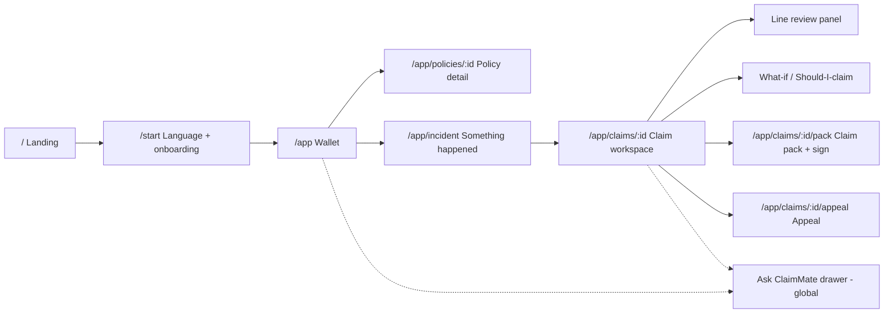

# ClaimMate: UI Implementation Plan

> **Design concept: "The Modern Bahi-Khata"**
> The red-cloth ledger Indian families and shopkeepers have trusted for generations, rebuilt as a precise, editorial, modern interface.
> Paper, ink, hairlines, rubber stamps, margin notes. **Nothing about it should look like a template or an AI-generated site.**

Companion to [IMPLEMENTATION_PLAN.md](./IMPLEMENTATION_PLAN.md) (backend and agents). This document covers **only the frontend**.

---

## 1. Design Principles

| # | Principle | What it means in practice |
|---|---|---|
| 1 | **Paper, not glass** | Warm paper surfaces, ink text, hairline rules. No glassmorphism, no glowing blobs, no gradient meshes |
| 2 | **Numbers are the hero** | Money is shown big, in a serif display face with tabular figures. Every rupee is traceable |
| 3 | **Show the evidence** | Every AI conclusion sits next to its source, like a margin note in an annotated document |
| 4 | **Deliberate human moments** | Approvals are physical gestures (*hold to sign*), never a casual click |
| 5 | **Speak the user's script** | Indic scripts are first-class typography, not a fallback font |
| 6 | **Quiet until it matters** | A mostly monochrome UI. Colour appears **only** to mean payable / uncertain / deducted |
| 7 | **Real, specific copy** | "₹16,850 cut because your room cost ₹8,000/day and your limit is ₹5,000", never "Unlock powerful insights" |

### ❌ The "AI-generated look": banned list
- Purple→blue gradients, neon glows, aurora backgrounds, floating 3D blobs
- Glassmorphism cards, `backdrop-blur` everywhere
- ✨ sparkle icons, "AI-powered" badges, robot illustrations
- Emoji used as icons
- Centered hero + 3 identical feature cards with icons in circles
- `rounded-2xl` on everything, soft grey drop shadows on everything
- Default shadcn/ui theme, default Lucide icon set, Inter as the only font
- Generic copy: "Revolutionize", "Seamless", "Unlock", "Get started for free"
- Stock photos of smiling families or doctors

### ✅ Signature elements (what makes it memorable)
1. **The Receipt.** Line items on a perforated paper slip that "prints" row by row
2. **Rubber stamps.** `PAYABLE`, `DEDUCTED`, `NEEDS YOU`, `MISSING` thump onto rows with a slight rotation and ink texture
3. **Marginalia.** Policy citations sit in the right margin, connected to the line item by a hairline
4. **Giant numerals.** Payout figures in large serif type with a mechanical number-roll animation
5. **Hold-to-sign.** Approval gates need a 1.2 s press that draws an ink signature stroke
6. **The Seal.** The voice button is a round wax-seal-like control with a live ink waveform
7. **Ticker tape.** The agents' live activity log in monospace, like a printing calculator roll
8. **Index tabs.** Insurance types appear as physical folder tabs (Health, Motor, Life…)
9. **Script marquee.** "दावा · கோரிக்கை · దావా · দাবি · ਦਾਅਵਾ · ದಾವೆ" scrolling slowly in each script ("claim" in each language)

---

## 2. Visual Language

### 2.1 Colour tokens

| Token | Light | Dark ("Night ledger") | Use |
|---|---|---|---|
| `--paper` | `#F3EFE6` | `#11110F` | App background |
| `--paper-raised` | `#FBF9F4` | `#1A1A17` | Cards, receipt |
| `--paper-sunk` | `#E9E4D8` | `#0B0B0A` | Wells, inputs, trays |
| `--ink` | `#151513` | `#ECE7DC` | Primary text, borders on focus |
| `--graphite` | `#5C5A54` | `#A19D93` | Secondary text |
| `--rule` | `#D8D1C2` | `#2C2B27` | Hairlines, table rules |
| `--bahi` | `#B3261E` | `#E5533F` | **Brand red** (from the bahi-khata binding). Used sparingly: logo, primary CTA, `DEDUCTED` stamps |
| `--ledger` | `#1E6B45` | `#4FB585` | Payable / approved |
| `--haldi` | `#C98A0B` | `#E8B23A` | Uncertain / needs review (turmeric) |
| `--highlight` | `#F6E27A` | `#6B5E12` | Citation highlighter mark on policy text |
| `--focus` | `#151513` | `#ECE7DC` | 2 px focus ring + 2 px offset |

**Ratio rule:** ~85% paper/ink, ~10% graphite/rules, ≤5% semantic colour. If a screen looks colourful, something is wrong.

### 2.2 Typography

| Role | Latin | Indic (all scripts) | Notes |
|---|---|---|---|
| **Display** (headlines, big numbers) | **Instrument Serif** (regular + *italic*) | **Noto Serif** per script (Devanagari, Tamil, Telugu, Bengali…) | Italic for emphasis in Latin only. Never italicise Indic |
| **UI / body** | **Geist** | **Anek** superfamily (Anek Devanagari, Anek Tamil, Anek Telugu, Anek Bangla, Anek Kannada, Anek Malayalam, Anek Gujarati, Anek Gurmukhi, Anek Odia) | Anek gives one consistent voice across 9 scripts |
| **Numbers / data / logs** | **Geist Mono** (tabular) | — | Amounts, clause IDs, timestamps, policy numbers |

**Type scale** (fluid, `clamp`):

| Token | Size | Use |
|---|---|---|
| `display-xl` | clamp(56px, 9vw, 144px) / 0.95 | Landing hero, payout figure |
| `display-l` | clamp(40px, 5vw, 72px) / 1.0 | Section titles |
| `display-m` | 36px / 1.1 | Screen titles |
| `title` | 20px / 1.3, 500 | Card titles |
| `body` | 16px / 1.55 (Indic: **1.75**) | Default |
| `small` | 13px / 1.45 (Indic: 1.65) | Meta, captions |
| `mono-s` | 12px / 1.4, uppercase, +0.06em tracking | Labels, stamps, ticker |

**Indic typography rules**
- Line height +0.2 for all Indic scripts (taller matras and conjuncts)
- No letter-spacing and no uppercase transforms on Indic text
- Digits stay Western (0–9). Money always uses `Intl.NumberFormat('en-IN')` → **₹1,21,300**
- Load fonts per locale with `next/font` subsets so a Hindi user doesn't download Tamil fonts

### 2.3 Space, grid, shape
- **Base unit 4 px.** Spacing scale: 4, 8, 12, 16, 24, 32, 48, 64, 96, 128
- **Grid:** 12 columns, 24 px gutter, max width 1360 px. Landing hero shows **faint column guides** (1 px `--rule` at 40% opacity), like ruled ledger paper
- **Radius:** `2px` (default), `6px` (inputs, cards), `999px` (chips only). **No `rounded-2xl`.**
- **Borders over shadows:** 1 px `--rule` hairlines. One allowed shadow style, a **hard offset shadow** `4px 4px 0 var(--ink)` for the primary CTA and the active receipt
- **Texture:** a 3% SVG noise overlay on `--paper` (fixed, `pointer-events: none`) and an optional faint 32 px ruled-line background in the ledger area

### 2.4 Iconography & imagery
- **Phosphor Icons** (Light weight, 1.5 px look). Not Lucide (the default "AI look")
- Custom SVG set (8–10 icons) for domain concepts: hospital bed, car, policy scroll, stamp, seal, rupee coin, IRDAI shield
- **No photos.** Illustrations, where used, are **ink line drawings** (single-weight strokes, no fills), such as a hand holding a bill or a car outline
- Document thumbnails are rendered from the actual uploaded files (real bills and pages)

### 2.5 Motion

| Pattern | Spec | Where |
|---|---|---|
| Ease | `cubic-bezier(0.2, 0.8, 0.2, 1)` ("ledger ease") | Everything |
| Durations | 120 ms (hover), 220 ms (UI), 420 ms (enter), 700 ms (hero) | |
| **Print-in** | Rows reveal top→bottom, 40 ms stagger, 6 px rise + clip-path wipe | Receipt / ledger |
| **Stamp** | scale 1.6→1, rotate −8°→−4°, opacity 0→1 in 180 ms + 2 px "thump" shake on the parent | Status stamps |
| **Number roll** | Each digit rolls in its own column, 600 ms, staggered right→left | Payout figures |
| **Ink sign** | SVG stroke-dashoffset drawn over a 1.2 s hold; releasing early rewinds it | Approval gates |
| **Ticker** | New log lines type on at 18 ms/char in mono, auto-scroll | Agent timeline |
| **Marginalia link** | Hairline draws from the row to the margin note (stroke animation, 250 ms) | Citation hover/select |
| Page transitions | 220 ms cross-fade + 8 px slide, no zoom | Route changes |
| Smooth scroll | Lenis, **landing page only** | |
| Reduced motion | `prefers-reduced-motion` → all of the above become instant opacity fades | Global |

---

## 3. Tech Stack (frontend)

| Concern | Choice | Why |
|---|---|---|
| Framework | **Next.js (App Router) + TypeScript** | Routing, `next/font`, locale segments |
| Styling | **Tailwind CSS v4** with tokens in `@theme` + CSS variables | Theme switching, no config sprawl |
| Primitives | **Radix UI** (Dialog, Popover, Tooltip, Tabs, Slider, Toggle, ScrollArea, VisuallyHidden) **fully custom-styled** | Accessibility without the default shadcn look |
| Motion | **Motion** (`motion/react`) | Layout animations, stamps, number roll |
| Smooth scroll | **Lenis** (landing only) | |
| Icons | **@phosphor-icons/react** + custom SVG sprite | |
| i18n | **next-intl** (`/[locale]/…`) | Message files pre-translated with Sarvam Translate |
| Data | **TanStack Query** + **Zustand** (UI state: selected line, language, gates) | |
| Live updates | `EventSource` hook for SSE (agent ticker) | |
| PDF | **react-pdf** (pdf.js) + custom highlight layer | Citation viewer |
| Audio | `MediaRecorder` + `AnalyserNode` → canvas waveform; `<audio>` for TTS | |
| Charts | **Hand-built SVG** (payout bar, NCB balance), no chart library | Avoids the generic dashboard look |
| Mocking | **MSW** (Mock Service Worker) with fixture JSON | UI work starts at hour 0 without the backend |
| Quality | ESLint, Prettier, `@axe-core/react` in dev, Playwright smoke test | |

---

## 4. Information Architecture



All routes live under `/[locale]/…` (e.g. `/hi/app/claims/123`).

---

## 5. Screen-by-Screen Specification

### 5.1 Landing page `/`

```
┌──────────────────────────────────────────────────────────────────────────┐
│ ▌ClaimMate                      How it works  Languages  Insurers   [हिं ▾] [Open app →]│
├──────────────────────────────────────────────────────────────────────────┤
│ ┊      ┊      ┊      ┊      ┊      ┊      ┊      ┊      ┊      ┊      ┊   │  ← faint column guides
│  Every rupee                                 ┌─────────────────────────┐   │
│  of your claim,                              │ APOLLO-ISH HOSPITAL     │   │
│  *explained.*                                │ Room rent ×3  24,000    │   │
│                                              │   [PARTIAL]  ─────────── Cl. 4.2 ↗ │
│  ClaimMate reads your policy and bills,      │ Gloves         1,250    │   │
│  tells you what you'll get back and why,     │   [DEDUCTED] ─────────── IRDAI L-I │
│  in your language.                           │ MRI (pre-hosp) 8,400    │   │
│                                              │   [PAYABLE]             │   │
│  [ Check my claim → ]  ▶ Hear it in Tamil    │ ─ ─ ─ ─ ─ ─ ─ ─ ─ ─ ─ ─ │   │
│                                              │ YOU GET  ₹1,21,300      │   │
│                                              └─╲╱╲╱╲╱╲╱╲╱╲╱╲╱╲╱╲╱╲╱╲╱╲╱┘   │  ← perforated edge
├──────────────────────────────────────────────────────────────────────────┤
│  दावा · கோரிக்கை · దావా · দাবি · ਦਾਅਵਾ · ದಾವೆ · ദാവ · દાવો · ଦାବି · Claim → (marquee) │
├──────────────────────────────────────────────────────────────────────────┤
│  ₹26,000 cr                                                               │
│  of health claims were cut or rejected in FY24.¹                          │
│  ¹ IRDAI Annual Report 2023–24                                             │
├──────────────────────────────────────────────────────────────────────────┤
│  HOW IT WORKS                                                             │
│  01 ── Keep your policies in one wallet ............................  →   │
│  02 ── Tell us what happened. Speak in any language. .............   →   │
│  03 ── We read every bill and check it against every clause .......  →   │
│  04 ── You review, edit and sign. Nothing is filed without you. ...  →   │
├──────────────────────────────────────────────────────────────────────────┤
│  [Health][Motor][Life][Travel][Home][Crop]   ← index tabs, active tab lifts│
│  (tab body: one concrete example per insurance type)                       │
├──────────────────────────────────────────────────────────────────────────┤
│  YOU STAY IN CONTROL         ( hold to sign demo ~~~~~~~ )                │
├──────────────────────────────────────────────────────────────────────────┤
│  ClaimMate  (giant wordmark, cropped by the viewport bottom)              │
└──────────────────────────────────────────────────────────────────────────┘
```

**Sections & behaviour**
1. **Nav**: 56 px, paper background, hairline bottom on scroll. Language switcher shows **the script name** (हिन्दी, தமிழ்), not a flag
2. **Hero**: left 6 columns headline (`display-xl`, italic accent word); right 5 columns **live Receipt** that prints rows on load and stamps them one by one, with margin notes drawing in. Loops every 12 s; pauses on hover
3. **"Hear it in Tamil"**: plays a pre-generated Bulbul clip; the button shows an ink waveform while playing
4. **Script marquee**: 48 px Noto Serif per script, 40 s loop, pauses on hover; each word shows a language tooltip
5. **Stat block**: giant number roll on scroll-into-view, with a footnote-style source
6. **How it works**: a **ledger list**, not cards. Dotted leaders between text and arrow; on hover the row fills with `--paper-raised` and a small illustration slides in from the right
7. **Index tabs**: folder tabs; switching animates the tab body with layout animation
8. **Control section**: an interactive hold-to-sign demo ("Try it, hold for 1 second")
9. **Footer**: giant cropped wordmark, colophon-style credits ("Set in Instrument Serif, Geist and Anek. Built with Sarvam AI.")

### 5.2 Onboarding `/start`

```
┌──────────────────────────────────────────────────────────────┐
│  Choose your language · अपनी भाषा चुनें · உங்கள் மொழியைத் தேர்ந்தெடுக்கவும் │
│                                                              │
│   ┌────────┐ ┌────────┐ ┌────────┐ ┌────────┐ ┌────────┐     │
│   │ हिन्दी   │ │ தமிழ்   │ │ తెలుగు  │ │ বাংলা  │ │ मराठी   │     │
│   │ Hindi  │ │ Tamil  │ │ Telugu │ │ Bangla │ │ Marathi│     │
│   └────────┘ └────────┘ └────────┘ └────────┘ └────────┘     │
│   … 11 tiles, then "More languages (text only) ▾"              │
│                                                              │
│           ( ◉ )  Or just say hello in your language           │
└──────────────────────────────────────────────────────────────┘
```
- Tiles: 160×120, script in `display-m` Noto Serif, English name in `mono-s`. Selected = ink border + offset shadow
- **Voice detect:** tap the Seal and say anything → Saaras detects the language → the matching tile stamps `SELECTED`
- Step 2: "Add your first policy" (drag a PDF, or "Use a sample policy" for the demo)

### 5.3 Wallet `/app`

```
┌────┬─────────────────────────────────────────────────────────────────┐
│ ▌  │  Your policies                                [ Something happened ● ]│
│ ⌂  │  4 policies · ₹27L total cover · next renewal in 41 days           │
│ ▤  ├─────────────────────────────────────────────────────────────────┤
│ ✉  │ ┌─HEALTH──────────────┐ ┌─MOTOR───────────────┐ ┌─LIFE─────────┐ │
│ ?  │ │ Family Floater       │ │ Private Car OD + TP │ │ Term Plan     │ │
│    │ │ ₹5,00,000            │ │ IDV ₹6,40,000       │ │ ₹1,00,00,000  │ │
│    │ │ Room limit ₹5,000/day│ │ No-claim bonus 35%  │ │ Nominee: Asha │ │
│    │ │ Co-pay 10%           │ │ Zero-dep ✕          │ │               │ │
│    │ │ ✓ 14 rules decoded   │ │ ✓ 9 rules decoded   │ │ ◐ decoding…   │ │
│    │ └──────────────────────┘ └─────────────────────┘ └───────────────┘ │
│    │  COVERAGE CHECK                                                    │
│    │  Hospitalisation ████████████░░  Personal accident ███░░░░  Gap!   │
└────┴─────────────────────────────────────────────────────────────────┘
```
- **Left rail** 64 px, icons only + tooltip. Expands to 220 px on hover (desktop) / bottom tab bar (mobile)
- **Policy card = a physical document**: a coloured folder tab on top (type colour is a *muted* tint: health = ledger green, motor = ink blue-grey, life = graphite), body on `--paper-raised`, key facts in mono, decode status as a mini ticker
- Hovering a card tilts it 1° and shows a "View clauses →" footer
- **"Something happened"**: the primary CTA (bahi red, hard offset shadow) with a slow pulsing dot
- **Coverage check**: thin SVG bars with hatched "gap" segments (diagonal hatching, not red fill)
- Decoding state: the card shows a **printing shimmer** (horizontal lines appearing) instead of a grey skeleton

### 5.4 Policy detail `/app/policies/:id`
- Two panes: **left** = decoded rules as a ledger (rule · value · page); **right** = PDF viewer
- Clicking a rule scrolls the PDF to the page and paints the quote with a `--highlight` marker stroke (slightly irregular SVG path, like a real highlighter)
- Rules with `unverified` citations get a `NEEDS YOU` haldi stamp with a "Confirm or correct" inline editor

### 5.5 Incident triage `/app/incident`

```
┌──────────────────────────────────────────────────────────────┐
│                 What happened?                                │
│         Speak in any language, or type below.                 │
│                                                              │
│                        ╭──────╮                              │
│                       │  ◉   │   ← The Seal (hold to talk)   │
│                        ╰──────╯                              │
│           ∿∿∿∿∿∿∿∿∿∿∿∿∿∿∿  0:07 / 0:30                      │
│                                                              │
│  "पापा का accident हुआ, 3 दिन hospital में थे"   [हिन्दी + English]  ✎ │
│   Is this right?   [ Yes, continue ]  [ Re-record ]           │
├──────────────────────────────────────────────────────────────┤
│  4 POLICIES MAY PAY                                           │
│  ┌ ☑ Health · Family Floater ........ est. ₹92,500 · 15 days ┐│
│  ┌ ☑ Motor · Own damage ............. est. ₹38,200 · 48 HRS ⚠┐│
│  ┌ ☑ Personal accident (in motor) ... if disability criteria  ┐│
│  ┌ ☐ Credit card cover .............. you may not know this  ┐│
│                                     [ Start 3 claims → ]      │
└──────────────────────────────────────────────────────────────┘
```
- **The Seal**: 120 px circle, `--bahi` with an embossed inner ring (two concentric hairlines + subtle inner shadow). Press → ring expands; release → transcribe
- **Waveform**: canvas, a single ink-coloured line (not bars), from `AnalyserNode`
- **30 s timer ring** around the Seal (SVG arc)
- **Transcript confirmation = a human gate.** Editable inline. The language chip shows the detected script(s) (Saaras code-mix)
- **Triage slips** slide in staggered like paper slips being dealt. Urgent deadlines get a `48 HRS` bahi stamp
- The CTA counts the selected slips ("Start 3 claims")

### 5.6 Claim workspace `/app/claims/:id` (the main screen)

```
┌────┬──────────────┬──────────────────────────────────────┬──────────────────┐
│rail│ DOCUMENTS    │  Health claim · Ramesh Kumar          │ MARGIN           │
│    │ ┌──┐ Bill 1 ✓│  Admitted 12 Sep · Discharged 15 Sep  │                  │
│    │ ┌──┐ Bill 2 ✓│                                       │ Cl. 4.2, p.12    │
│    │ ┌──┐ Bill 3 ◐│  YOU SHOULD GET                       │ "Room rent up to │
│    │ ┌──┐ D/S   ⚠ │  ₹1,21,300                            │  1% of SI per    │
│    │ + Add files  │  of ₹1,48,600 billed                  │  day…"           │
│    │              │  ▇▇▇▇▇▇▇▇▇▇▇▇▇▇▇▇▇▇░░░░▒▒              │  ────────────────│
│    │ CHECKLIST    │  payable · deducted · uncertain       │ [Open page ↗]    │
│    │ ✓ Claim form │                                       │                  │
│    │ ✓ Bills (7)  │  ┌ RECEIPT ─────────────────────────┐ │ DEADLINES        │
│    │ ✕ Pharmacy Rx│  │ Filter: All · Deducted · Needs you│ │ Submit by 30 Sep │
│    │ ✕ Signed D/S │  │ Room rent ×3   24,000 → 15,000 [PARTIAL]─┤ ▓▓▓▓▓░░ 14 days │
│    │              │  │ Surgeon fee    40,000 → 25,000 [PARTIAL] │                  │
│    │              │  │ Gloves (×40)    1,250 →      0 [DEDUCTED]│ YOU MIGHT HAVE   │
│    │              │  │ MRI 31 Aug      8,400 →  8,400 [PAYABLE] │ MISSED ₹12,400   │
│    │              │  │ …                                  │ │                  │
│    │              │  └╲╱╲╱╲╱╲╱╲╱╲╱╲╱╲╱╲╱╲╱╲╱╲╱╲╱╲╱╲╱╲╱╲╱╲╱┘ │                  │
├────┴──────────────┴──────────────────────────────────────┴──────────────────┤
│ ▸ 10:42:03  Reading bill 3 of 7 (Marathi)…  10:42:05  Applied Cl. 4.2 room cap… │ ← ticker
└──────────────────────────────────────────────────────────────────────────────┘
```

**Zones**
| Zone | Width | Content |
|---|---|---|
| Documents tray | 240 px | Real thumbnails, status glyphs (✓ read, ◐ reading, ⚠ issue), drag to add, checklist below |
| Centre | flexible | Header → **payout block** → **payout bar** → **Receipt ledger** |
| Margin | 320 px | Citation note for the selected row, deadlines, "you might have missed", what-if entry |
| Ticker | 36 px, expandable to 240 px | Live agent log from SSE (mono, timestamped) |

**Payout block:** `display-xl` Instrument Serif, number roll on every recompute. Below it a **single stacked bar** (payable = ledger, deducted = bahi with diagonal hatching, uncertain = haldi dotted). Hovering a segment filters the receipt.

**Receipt ledger rows:** `description · billed (mono) → payable (mono) · stamp`. Dotted leader lines. Rows with overrides show a small "edited by you" ink initial (e.g. **R.K.**).

**Interactions**
- Click a row → it lifts (hard shadow) → a hairline draws to the margin note → the margin shows the clause + "Open page"
- `J` / `K` move between rows; `A` approve, `E` edit, `D` dispute (keyboard power-user mode)
- Filter chips: *All · Deducted · Needs you · Pre/post-hospitalisation*

### 5.7 Line review panel (opens over the margin, 480 px)
```
┌──────────────────────────────────────────────┐
│ Surgeon fee                    ₹40,000 → ₹25,000 │
│ [PARTIAL]  Rule H6 · Proportionate deduction      │
│                                                  │
│ WHY                                              │
│ Your room cost ₹8,000/day. Your policy covers    │
│ ₹5,000/day (Cl. 4.2). So associated charges are  │
│ paid at 62.5%.                                   │
│  5,000 ÷ 8,000 = 62.5%   ← shown as a calculation │
│                                                  │
│ SOURCE  (policy page 12, highlighted)            │
│ ┌──────────────────────────────────────────┐    │
│ │ …▇▇Room rent up to 1% of Sum Insured▇▇…   │    │
│ └──────────────────────────────────────────┘    │
│ Confidence ●●●○  (high)                          │
│                                                  │
│ [ Looks right ]  [ Edit category ▾ ]  [ Dispute ] │
│ 🔊 Explain in Hindi                               │
└──────────────────────────────────────────────┘
```
- The calculation is shown **as arithmetic in mono**. Transparency is the feature
- Dispute → text box ("Tell us why") → logged in the audit trail → engine reruns → the number rolls

### 5.8 What-if (room rent) and Should-I-claim (motor)

**Room-rent ruler slider**
```
 ROOM RENT PER DAY
 ₹2k   ₹3k   ₹4k   ₹5k   ₹6k   ₹7k   ₹8k   ₹9k
  |  '  |  '  |  '  |  '  ▲  '  |  '  |  '  |
                    LIMIT  └ you chose ₹8,000
 General ward · Twin sharing · Single · Deluxe   ← room type toggle
 At ₹5,000/day you'd get ₹1,38,150 (+₹16,850)
```
- A **ruler-styled Radix Slider**: tick marks, a ledger-green "limit" marker, a mono readout. The payout figure above updates live (no LLM call, pure engine maths)

**Should I claim? (motor), a balance scale**
```
        YOU GET                       YOU LOSE
        ₹4,500                        ₹6,800
     (after depreciation          (no-claim bonus over
      & deductible)                next 3 renewals)
   ─────────────╲          ╱───────────────
                 ╲   ▲   ╱      ← SVG beam tilts toward the heavier side
              [ DON'T CLAIM ]  ← stamp
   Pay ₹4,500 yourself and keep your 35% no-claim bonus.
```
- SVG beam rotates with spring physics. Expanding "How we calculated" shows a mono table

### 5.9 Claim pack & sign `/app/claims/:id/pack`
- **Left:** the filled claim form preview (react-pdf), with auto-filled fields tinted `--highlight` at 30% so the user sees what was filled
- **Right:** "Document pack": a table of contents like a book index (`01 Claim form ........ p.1`), all items ✓ or ✕
- **Bottom: Hold-to-sign bar**
```
 ┌───────────────────────────────────────────────────────────────┐
 │  I've reviewed the 14 flags and the claim form.               │
 │  ~~~~~~~~~~~~~~~~~~~~~~~~~~~~~~~~~~~~~~  ← ink stroke draws while held │
 │  [ Hold to sign & prepare pack ]   (1.2 s)                    │
 └───────────────────────────────────────────────────────────────┘
```
- On completion: an `APPROVED BY YOU` stamp + timestamp, and the download buttons appear. **Nothing is ever submitted to the insurer by the app.** Copy says "You submit it, we prepared it."

### 5.10 Ask ClaimMate (global drawer, right, 420 px)
- Chat in the user's language. Answers render as **notes**: text + citation chips (`Cl. 4.2 ↗`, `Bill 3 · line 7 ↗`) that open the relevant panel
- Mic = mini Seal. Every answer has a 🔊 play button (Bulbul) with an inline ink waveform
- Suggested questions as plain underlined text links (not pill chips): "Why was ₹16,850 cut?", "क्या दवाई का पैसा मिलेगा?"

### 5.11 Appeal `/app/claims/:id/appeal`
- Upload the rejection letter → a vertical **escalation rail**: `Insurer grievance officer → Bima Bharosa → Insurance Ombudsman`, each with an SLA countdown
- **Bilingual letter view**: English (to send) and the user's language (to understand) side by side, synced scroll, paragraph-matched highlighting
- Editable, with "Copy", "Download PDF" and a hold-to-sign before export

### 5.12 Mobile (≤ 768 px)
- Bottom tab bar: Wallet · Incident (centre Seal, raised) · Claims · Ask
- Claim workspace becomes **stacked sheets**: Summary → Receipt → (row tap opens a bottom sheet with the margin content)
- The ticker becomes a single-line status pill at the top
- Hold-to-sign works with touch (with haptic `navigator.vibrate(10)` where supported)

---

## 6. Component Inventory

| Component | Variants / states | Notes |
|---|---|---|
| `Button` | primary (bahi + offset shadow), secondary (ink outline), ghost, link | Press: shadow collapses (translate 2px) |
| `HoldToSign` | idle, holding (stroke progress), signed, disabled | Keyboard: hold `Space` / `Enter`; screen reader: a "Confirm" dialog fallback |
| `Stamp` | payable, partial, deducted, needs-you, missing, approved, urgent | SVG with an ink-texture mask, random rotation −6°…−2° seeded by id |
| `Receipt` / `LedgerRow` | default, selected, edited, loading (printing) | Perforated edge SVG mask top/bottom |
| `MoneyFigure` | xl, l, m; `roll` on change | `Intl.NumberFormat('en-IN')`, tabular figures |
| `PayoutBar` | interactive segments | Hatch patterns via SVG `<pattern>` |
| `MarginNote` | citation, tip, warning | Connector line drawn with an absolutely positioned SVG |
| `CitationViewer` | page loading, highlighted, unverified | react-pdf + highlight overlay from the quote's text-layer match |
| `Seal` (voice) | idle, listening, processing, error | Timer ring, waveform canvas |
| `Waveform` | live (mic), playback (TTS) | Single ink line, 60 fps canvas |
| `Ticker` | collapsed, expanded, paused | Virtualised list, autoscroll lock when the user scrolls up |
| `PolicyCard` | decoding, ready, needs-review, expired | Folder-tab header |
| `IndexTabs` | — | Radix Tabs, layout-animated active tab |
| `ScriptMarquee` | — | CSS animation, pauses on hover / reduced motion |
| `RulerSlider` | — | Radix Slider + tick SVG |
| `BalanceScale` | claim / don't claim / close call | SVG + spring |
| `LanguageSwitcher` | compact (nav), full (onboarding) | Script-first labels |
| `ListenButton` | idle, loading, playing | Fetches TTS audio, caches it per language |
| `DocThumb` | reading, done, issue, low-quality | Rendered first page, status glyph |
| `ChecklistItem` | ok, missing, invalid (with reason) | |
| `EmptyState` | per screen | Ink line illustration + one specific sentence |
| `Toast` | info, success, error | Bottom-left slip that "tears off" on dismiss |

---

## 7. States & Edge Cases (designed, not afterthoughts)

| Situation | Design |
|---|---|
| Loading (Doc AI jobs take seconds to minutes) | **Printing shimmer**: lines draw left→right on the receipt; the ticker narrates progress ("Reading page 14 of 38") |
| Empty wallet | Ink drawing of an empty folder + "Add your first policy. A PDF from your insurer's email is perfect." + "Try a sample policy" |
| Low-quality photo | DocThumb shows `RETAKE` haldi stamp + tip: "Bill is blurry near the total. Retake in good light." |
| Unverified citation | `NEEDS YOU` stamp, and the margin says "We couldn't find this exact text in your policy. Please confirm." |
| Network / API error | Paper-slip toast with a retry; the ticker logs the error in mono; no red full-screen errors |
| Unsupported voice language (Tier B) | Text reply in their language + "Audio available in English" note |
| Long text in Indic (wraps longer) | All containers tested with Tamil/Malayalam strings (they run ~30–40% longer) |
| Demo mode | Tiny `DEMO DATA` mono label in the nav corner (honest UI) |

---

## 8. Accessibility

- **WCAG 2.2 AA.** Check every token pair (ink/paper ≈ 16:1, graphite/paper ≥ 4.5:1, stamp colours with an ink outline for non-colour cues)
- **Never rely on colour alone:** stamps always carry a text label, and payout bar segments use hatch patterns
- Visible focus: 2 px ink ring + 2 px offset on everything interactive
- Full keyboard paths for every gate. `HoldToSign` has a keyboard hold plus an accessible confirm alternative
- **"Easy mode" toggle** (for elderly users): +25% type scale, simplified single-column layout, voice-led prompts auto-play, larger hit targets (min 48 px)
- `aria-live="polite"` on the ticker and the payout figure; screen-reader text: "Expected payout updated to 1 lakh 21 thousand 300 rupees"
- Respect `prefers-reduced-motion` and `prefers-color-scheme`
- `lang` attribute set per locale so screen readers switch voices correctly

---

## 9. Multilingual UI Implementation

| Item | Approach |
|---|---|
| Routing | `/[locale]/…` with next-intl middleware; default from `Accept-Language`, overridden by the user's choice (cookie) |
| Static strings | `messages/en.json` is the source of truth → `scripts/translate-messages.ts` calls **Sarvam Translate** → `hi.json`, `ta.json`, `te.json`, `bn.json`, `mr.json`, `gu.json`, `kn.json`, `ml.json`, `pa.json`, `od.json`. Then a human pass on Hindi + one more |
| Protected tokens | ICU placeholders (`{amount}`, `{clause}`) are never translated. The script validates every placeholder survives |
| Dynamic content | Comes from the API already localised (backend masked translation) |
| Fonts | `src/lib/fonts.ts` maps locale → font variables. Loaded per locale segment |
| Script-specific CSS | `:lang(hi), :lang(mr) { --lh-body: 1.75 }` etc.; disable `font-style: italic` and `text-transform` for Indic |
| Numbers | `formatINR()` helper, always `en-IN` grouping, Western digits |
| Language switch | Instant (client-side): swap messages + fonts and **re-request dynamic content** in the new language, with a short "ink wipe" transition |

---

## 10. Frontend Folder Structure

```
frontend/
├── messages/                       en.json, hi.json, ta.json, …
├── public/
│   ├── textures/noise.svg  perforation.svg  ink-mask.png
│   ├── illustrations/*.svg          (ink line drawings)
│   └── audio/hero-ta.mp3  hero-hi.mp3   (pre-generated Bulbul clips)
├── scripts/translate-messages.ts
├── src/
│   ├── app/
│   │   ├── [locale]/
│   │   │   ├── layout.tsx            fonts, providers, noise overlay
│   │   │   ├── page.tsx              Landing
│   │   │   ├── start/page.tsx        Onboarding
│   │   │   └── app/
│   │   │       ├── layout.tsx        Rail + Ask drawer + ticker slot
│   │   │       ├── page.tsx          Wallet
│   │   │       ├── policies/[id]/page.tsx
│   │   │       ├── incident/page.tsx
│   │   │       └── claims/[id]/
│   │   │           ├── page.tsx      Workspace
│   │   │           ├── pack/page.tsx
│   │   │           └── appeal/page.tsx
│   │   └── globals.css               @theme tokens, base, :lang rules
│   ├── components/
│   │   ├── brand/      Logo, Wordmark, ScriptMarquee
│   │   ├── ledger/     Receipt, LedgerRow, Stamp, MoneyFigure, PayoutBar
│   │   ├── evidence/   MarginNote, CitationViewer, Highlight
│   │   ├── voice/      Seal, Waveform, ListenButton
│   │   ├── control/    HoldToSign, ReviewPanel, DisputeForm
│   │   ├── sim/        RulerSlider, BalanceScale
│   │   ├── wallet/     PolicyCard, CoverageBars
│   │   ├── claim/      DocTray, DocThumb, Checklist, Deadlines, Ticker
│   │   ├── ask/        AskDrawer, AnswerNote
│   │   ├── landing/    Hero, HowItWorks, IndexTabs, ControlDemo, Footer
│   │   └── ui/         Button, Chip, Tabs, Dialog, Tooltip, Toast (Radix-based)
│   ├── hooks/          useSSE, useRecorder, useHold, useNumberRoll, useLocaleFont
│   ├── lib/            api.ts, formatINR.ts, fonts.ts, motion.ts (eases/durations), cn.ts
│   ├── store/          ui.ts (selected line, drawer, easy mode), claim.ts
│   └── mocks/          handlers.ts, fixtures/{wallet,claim_health,claim_motor,triage}.json
└── tests/e2e/demo-flow.spec.ts
```

---

## 11. Design Tokens (starter `globals.css`)

```css
@import "tailwindcss";

@theme {
  --color-paper: #F3EFE6;
  --color-paper-raised: #FBF9F4;
  --color-paper-sunk: #E9E4D8;
  --color-ink: #151513;
  --color-graphite: #5C5A54;
  --color-rule: #D8D1C2;
  --color-bahi: #B3261E;
  --color-ledger: #1E6B45;
  --color-haldi: #C98A0B;
  --color-highlight: #F6E27A;

  --font-display: var(--font-instrument-serif), var(--font-noto-serif-indic), serif;
  --font-sans: var(--font-geist), var(--font-anek), system-ui, sans-serif;
  --font-mono: var(--font-geist-mono), ui-monospace, monospace;

  --radius-xs: 2px;
  --radius-sm: 6px;

  --shadow-offset: 4px 4px 0 var(--color-ink);
  --ease-ledger: cubic-bezier(0.2, 0.8, 0.2, 1);
}

:root { --lh-body: 1.55; }
:lang(hi), :lang(mr), :lang(ta), :lang(te), :lang(bn), :lang(kn),
:lang(ml), :lang(gu), :lang(pa), :lang(or) {
  --lh-body: 1.75;
  & em, & i { font-style: normal; font-weight: 600; }
}

.dark {
  --color-paper: #11110F; --color-paper-raised: #1A1A17; --color-paper-sunk: #0B0B0A;
  --color-ink: #ECE7DC; --color-graphite: #A19D93; --color-rule: #2C2B27;
  --color-bahi: #E5533F; --color-ledger: #4FB585; --color-haldi: #E8B23A; --color-highlight: #6B5E12;
}

body {
  background: var(--color-paper);
  color: var(--color-ink);
  line-height: var(--lh-body);
  font-feature-settings: "tnum" 1, "ss01" 1;
}
.noise::after {               /* paper grain */
  content: ""; position: fixed; inset: 0; pointer-events: none;
  background: url("/textures/noise.svg"); opacity: .035; mix-blend-mode: multiply;
}
```

---

## 12. Mock Data Contracts (so UI and backend can be built in parallel)

```ts
// src/mocks/fixtures/claim_health.json (shape)
type ClaimView = {
  id: string; type: "health" | "motor"; status: ClaimStatus; lang: string;
  patient: string; admittedOn: string; dischargedOn: string;
  totals: { billed: number; payable: number; deducted: number; uncertain: number; missedPrePost: number };
  lines: Array<{
    id: string; docId: string; description: string; date: string;
    billed: number; payable: number;
    decision: "payable" | "partial" | "deducted" | "uncertain";
    ruleId: string; reason: string;               // already localised
    calc?: string;                                 // "5,000 ÷ 8,000 = 62.5%"
    citation?: { policyId: string; page: number; quote: string; verified: boolean };
    confidence: number; editedByUser?: boolean;
  }>;
  checklist: Array<{ id: string; label: string; status: "ok" | "missing" | "invalid"; reason?: string }>;
  deadlines: Array<{ id: string; label: string; due: string }>;
  documents: Array<{ id: string; kind: string; name: string; thumbUrl: string; status: "reading" | "done" | "issue"; lang?: string }>;
};
```
SSE event: `{ ts, agent, level: "info"|"warn"|"error", message, progress?: {done, total} }`

These shapes mirror the API in IMPLEMENTATION_PLAN.md §12. MSW returns fixtures until the backend is ready, so you switch with `NEXT_PUBLIC_USE_MOCKS=false`.

---

## 13. Build Order (aligned to the 30-hour plan)

| Hours | Frontend milestone | Output |
|---|---|---|
| **H0–H2** | Scaffold, tokens, fonts (Latin + Devanagari + Tamil), noise texture, `Button`, `Stamp`, `MoneyFigure` | A visual "style tile" page at `/dev/kit` |
| **H2–H6** | `Receipt` + `LedgerRow` + print-in, `PayoutBar`, `MarginNote` with mock data, MSW wired | Claim workspace centre column on mock data |
| **H6–H10** | Workspace layout (tray, margin, ticker with fake SSE), `ReviewPanel`, keyboard nav | **The main screen, demo-able on mocks** |
| **H10–H13** | Wallet + `PolicyCard`, policy detail + `CitationViewer` highlight | Wallet → policy flow |
| **H13–H17** | `Seal` + `Waveform` + recorder, incident triage slips, `ListenButton` | Voice flow (mock STT, then real) |
| **H17–H20** | Hook up the real API + SSE; next-intl + translated messages; Hindi QA | Real data in Hindi |
| **H20–H23** | `RulerSlider` what-if, `BalanceScale`, pack page + `HoldToSign`, Ask drawer | All human gates working |
| **H23–H25** | Landing page (hero receipt animation, marquee, how it works, index tabs, footer) | Pitch-ready front door |
| **H25–H27** | Mobile pass, easy mode, reduced motion, empty/error states, axe audit | Polish |
| **H27–H30** | Freeze. Demo rehearsal fixes only. Screenshots for the deck | — |

> [!TIP]
> Build the **style tile (`/dev/kit`) first**. Once the stamps, receipt and money figures look right, every screen after that inherits the look automatically.

---

## 14. "Does It Look AI-Generated?" Review Checklist

Run this on every screen before calling it done:

- [ ] Could this screen be mistaken for a default template? If yes, add a signature element (stamp, margin note, receipt edge, ruler)
- [ ] Is there any gradient, glow, blur or floating blob? Remove it
- [ ] Is colour used for anything other than meaning? Remove it
- [ ] Are there 3+ identical cards in a row with icons on top? Turn them into a ledger list or an asymmetric layout
- [ ] Is every number in mono or display serif with `en-IN` grouping?
- [ ] Does every AI statement show its source within one click?
- [ ] Is the copy specific (real ₹ amounts, clause numbers, dates)?
- [ ] Does it hold up in **Tamil** (longest strings) and **Hindi** (line height)?
- [ ] Does it work with keyboard only and with reduced motion?
- [ ] Would it look good printed in black and white? (The ledger aesthetic should survive greyscale)

---

## 15. Inspiration References (for mood, not copying)
- **Indian bahi-khata ledgers and rubber-stamped government documents**: colour, stamps, ruled lines
- **Stripe Press**: editorial serif typography and generous whitespace
- **Teenage Engineering**: precise, tactile controls (the Seal, ruler slider, hold-to-sign)
- **Swiss/International typographic style**: grid discipline, hairlines, asymmetric layouts
- **Old railway tickets and pharmacy receipts**: perforations, mono numerals, printed feel
